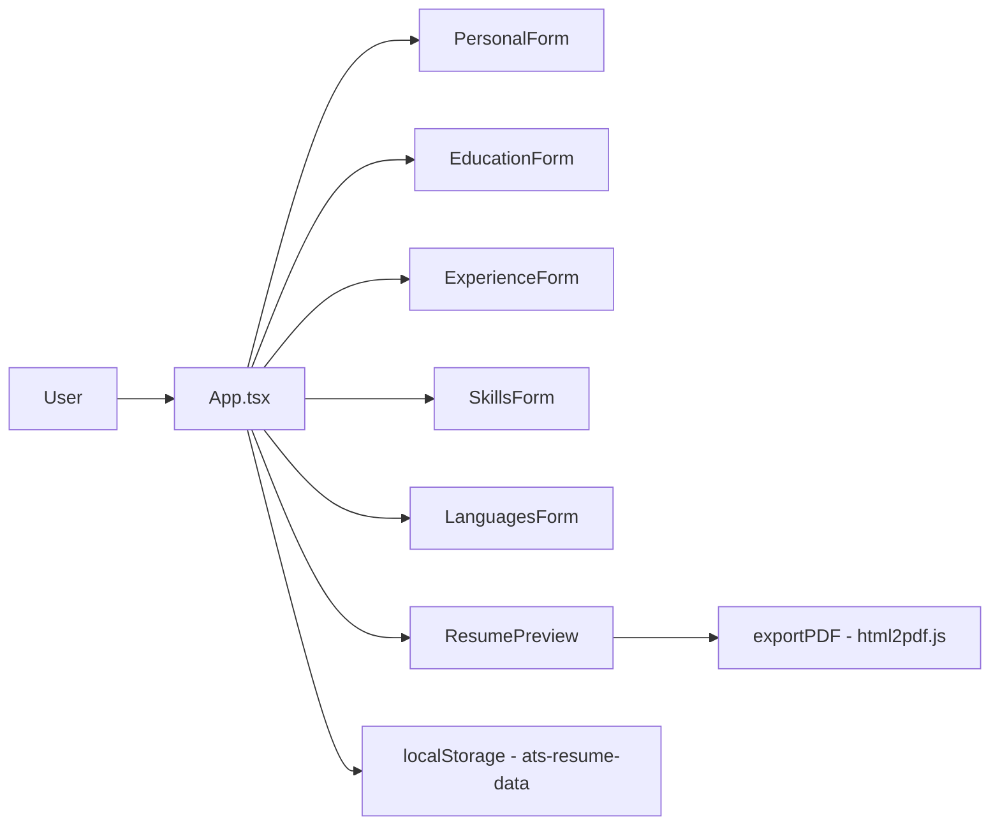

# gerador-de-curriculos-ats

**English** · [Português (Brasil)](README.md)

[](#) [](#) [](#) [](#) [](LICENSE)

## What it is

A **simple, clean, ATS-friendly résumé builder** (Applicant Tracking System). The user fills in forms — personal data, education, experience, skills and languages — and gets a clean CV in a live preview, with PDF export. Everything runs in the browser, with no backend.

## Status

In production. Published at <https://kelvinoliveiracode.github.io/gerador-de-curriculos-ats/> (HTTP 200 verified). Production build validated (`npm run build`).

> Divergence note: the `homepage` key in `package.json` points to `ats-resume-builder`, which returns 404. The URL that actually works is `gerador-de-curriculos-ats`. See `NEEDS_INPUT.md`.

## Features

- **5 section forms**: personal data, education, experience, skills and languages.
- **Live preview** of the CV in an ATS-friendly layout.
- **PDF export** via `html2pdf.js` (file named from the user's input).
- **Résumé language** (Portuguese / English) and a **bilingual UI** (`UI_LABELS`).
- **Automatic persistence** in `localStorage` (key `ats-resume-data`) — data survives reload.
- **Demo data** preloaded on first visit.
- **Clear-all button** with confirmation.

## Architecture

A single `App.tsx` holds the state (forms, preview, persistence); each section is a form component; `ResumePreview` renders the CV; `exportPDF` produces the PDF. There is no routing and no backend.



## Stack

- React 18.3, TypeScript 5.5
- Vite 5 (build), Tailwind CSS 3.4 + PostCSS
- html2pdf.js 0.10 (PDF)
- gh-pages 6 (deploy)

## Repository layout

```
gerador-de-curriculos-ats/
├── src/
│   ├── App.tsx                     # state + composition
│   ├── main.tsx                    # entry point
│   ├── components/                 # PersonalForm, EducationForm, ExperienceForm,
│   │                               # SkillsForm, LanguagesForm, ResumePreview, etc.
│   ├── hooks/useLocalStorage.ts    # persistence
│   ├── utils/exportPDF.ts          # html2pdf
│   ├── utils/demoData.ts           # demo data
│   ├── types/index.ts              # types and UI labels
│   └── styles/global.css
├── index.html · vite.config.ts · tsconfig.json
├── tailwind.config.js · postcss.config.js
├── DEPLOY.md                       # how to publish to GitHub Pages
└── LICENSE                         # MIT
```

## Prerequisites and installation

Node.js (npm).

```bash
git clone https://github.com/KelvinOliveiraCode/gerador-de-curriculos-ats.git
cd gerador-de-curriculos-ats
npm install
```

## How to run

```bash
npm run dev          # development server (Vite)
npm run build        # production build (tsc + vite build)
npm run preview      # preview the build
npm run deploy       # publish dist/ to GitHub Pages (gh-pages)
```

Build verified by the agent: `433 modules transformed`, `built in 6.71s`.

## Tests and quality

There is no test script (`npm test` does not exist in `package.json`) and no automated suite in this repository. Validation happens through `npm run build` (type-checking with `tsc`) and the manual in-browser flow. The build emits a >500 KB chunk warning (not an error).

## Technical decisions and trade-offs

- **All state in a single `App.tsx`** with `useState`/`useEffect` instead of Context or a state manager: simplicity for a single-screen app.
- **`localStorage` persistence** instead of a backend: data stays in the browser — privacy and zero-cost static deploy, but no cross-device sync.
- **`html2pdf.js` for export**: renders the preview to PDF on the client; the final layout depends on html2canvas fidelity.
- **Tailwind for the CV layout**, designed for machine readability (ATS).

## Known limitations and roadmap

- The résumé is generated locally; there are no alternative templates, auth or cloud.
- The PDF is a "snapshot" of the preview (html2canvas): long text may break pagination.
- The `homepage` key in `package.json` points to a URL that does not respond (use `gerador-de-curriculos-ats`).

## Development process

An individual project by Kelvin Oliveira, built with orchestrated AI agents and reviewed by the author. The component structure, the ATS-friendly design and the review are the author's.

## License and author

MIT — Copyright (c) 2026 Kelvin Rebelo de Oliveira.

**Author**: [Kelvin Oliveira](https://github.com/KelvinOliveiraCode) · [Portfolio](https://kelvinoliveiracode.github.io/portfolio/)
