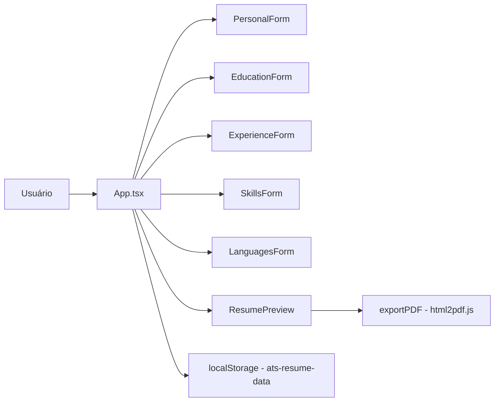

# gerador-de-curriculos-ats

[English](README.en.md) · **Português (Brasil)**

[](#) [](#) [](#) [](#) [](LICENSE)

## O que é

Gerador de currículos **simples, legível e amigável a sistemas ATS** (Applicant Tracking System). O usuário preenche formulários — dados pessoais, formação, experiência, habilidades e idiomas — e obtém um currículo limpo em preview, com exportação para PDF. Tudo roda no navegador, sem backend.

## Status

Em produção. Publicado em <https://kelvinoliveiracode.github.io/gerador-de-curriculos-ats/> (HTTP 200 verificado). Build de produção validado (`npm run build`).

> Nota de divergência: a chave `homepage` do `package.json` aponta para `ats-resume-builder`, que retorna 404. A URL que realmente funciona é `gerador-de-curriculos-ats`. Ver `NEEDS_INPUT.md`.

## Funcionalidades

- **5 formulários** de seção: dados pessoais, formação (educação), experiência, habilidades e idiomas.
- **Preview em tempo real** do currículo em layout ATS-friendly.
- **Exportação para PDF** via `html2pdf.js` (nome do arquivo pela entrada do usuário).
- **Idioma do currículo** (português / inglês) e **interface bilíngue** (`UI_LABELS`).
- **Persistência automática** em `localStorage` (chave `ats-resume-data`) — os dados sobrevivem ao reload.
- **Dados de demonstração** pré-carregados na primeira visita.
- **Botão limpar tudo** com confirmação.

## Arquitetura

Um `App.tsx` centraliza o estado (formulários, preview, persistência); cada seção é um componente de formulário; `ResumePreview` renderiza o currículo; `exportPDF` gera o PDF. Não há roteamento nem backend.



## Stack

- React 18.3, TypeScript 5.5
- Vite 5 (build), Tailwind CSS 3.4 + PostCSS
- html2pdf.js 0.10 (PDF)
- gh-pages 6 (deploy)

## Estrutura do repositório

```
gerador-de-curriculos-ats/
├── src/
│   ├── App.tsx                     # estado + composição
│   ├── main.tsx                    # entrada
│   ├── components/                 # PersonalForm, EducationForm, ExperienceForm,
│   │                               # SkillsForm, LanguagesForm, ResumePreview, etc.
│   ├── hooks/useLocalStorage.ts    # persistência
│   ├── utils/exportPDF.ts          # html2pdf
│   ├── utils/demoData.ts           # dados de demonstração
│   ├── types/index.ts              # tipos e rótulos UI
│   └── styles/global.css
├── index.html · vite.config.ts · tsconfig.json
├── tailwind.config.js · postcss.config.js
├── DEPLOY.md                       # como publicar no GitHub Pages
└── LICENSE                         # MIT
```

## Pré-requisitos e instalação

Node.js (npm).

```bash
git clone https://github.com/KelvinOliveiraCode/gerador-de-curriculos-ats.git
cd gerador-de-curriculos-ats
npm install
```

## Como executar

```bash
npm run dev          # servidor de desenvolvimento (Vite)
npm run build        # build de produção (tsc + vite build)
npm run preview      # pré-visualiza o build
npm run deploy       # publica dist/ no GitHub Pages (gh-pages)
```

Build verificado pelo agente: `✓ 433 modules transformed`, `✓ built in 6.71s`.

## Testes e qualidade

Não há script de teste (`npm test` não existe no `package.json`) nem suíte automatizada neste repositório. A validação é feita pelo `npm run build` (checagem de tipos com `tsc`) e pelo fluxo manual no navegador. O build gera um aviso de chunk > 500 KB (sem erro).

## Decisões técnicas e trade-offs

- **Todo o estado em um `App.tsx`** com `useState`/`useEffect` em vez de Context/state manager: simplicidade para um app de uma tela.
- **Persistência em `localStorage`** em vez de backend: dados ficam só no navegador — privacidade e deploy estático custo zero, mas sem sincronização entre dispositivos.
- **`html2pdf.js` para exportação**: renderiza o preview para PDF no cliente; o layout final depende da fidelidade do html2canvas.
- **Tailwind para o layout** do currículo, pensado para legibilidade por máquina (ATS).

## Limitações conhecidas e roadmap

- O currículo é gerado localmente; não há templates alternativos, autenticação ou nuvem.
- O PDF é uma "captura" do preview (html2canvas): textos longos podem quebrar a paginação.
- A chave `homepage` do `package.json` aponta para uma URL que não responde (usar `gerador-de-curriculos-ats`).

## Processo de desenvolvimento

Projeto individual de Kelvin Oliveira, construído com agentes de IA orquestrados e revisado pelo autor. A estrutura de componentes, o design ATS-friendly e a revisão são do autor.

## Licença e autor

MIT — Copyright (c) 2026 Kelvin Rebelo de Oliveira.

**Autor**: [Kelvin Oliveira](https://github.com/KelvinOliveiraCode) · [Portfólio](https://kelvinoliveiracode.github.io/portfolio/)
